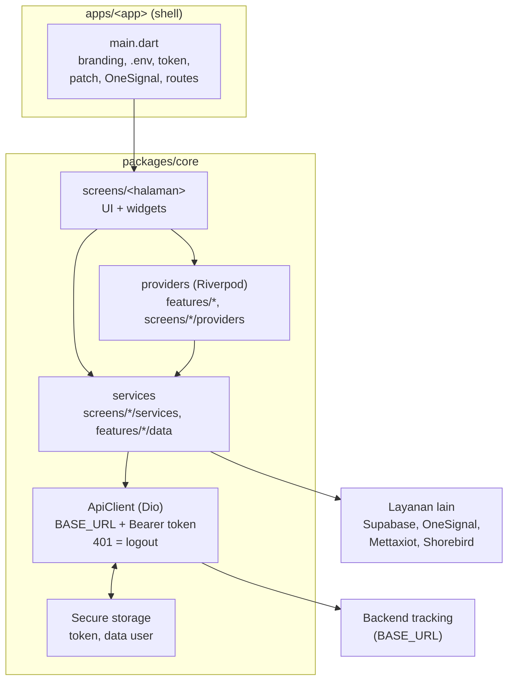

# 8. Arsitektur dan alur kode

[< 7. Menjalankan app](07-menjalankan-app.md) | [Daftar isi](../README.md) | [9. Fitur per halaman >](09-fitur.md)

App memakai pola sederhana: halaman (screen) memanggil service atau provider Riverpod, yang memanggil backend lewat satu klien HTTP bersama (`ApiClient`). Token login disimpan di secure storage HP, dan setiap request otomatis membawanya.

## 8.1 Isi `packages/core/lib`

| Folder | Isi |
| --- | --- |
| `base/network/` | `api_client.dart`: satu instance Dio dengan `BASE_URL`, header `Authorization: Bearer <token>` otomatis, dan logout otomatis saat server membalas 401. Juga logger request dan pengukur waktu request. |
| `base/routes/` | `app_routes.dart`: daftar nama route (`/login-screen`, `/home-screen`, dst). `navigation_service.dart`: `navigatorKey` global, dipakai untuk pindah halaman dari luar widget (mis. saat logout otomatis). |
| `base/services/` | Layanan tanpa UI: `code_push_service.dart` (Shorebird), `push_notification_service.dart` (OneSignal), `demo_mode.dart` + `demo_data.dart` (mode demo untuk reviewer), `app_users.dart` (Customer vs Teknisi). |
| `base/widgets/` | Widget bersama: `AuthGuard`, `GuestGuard`, banner dan popup patch, `AppVersionLabel`, input, toast, dialog, dll. |
| `base/res/` | `styles/app_styles.dart` (warna dan teks) dan `media.dart` (path asset). |
| `base/config/app_branding.dart` | Identitas brand yang di-set dari `main.dart`. |
| `base/localization/` | `locale_controller.dart`: provider bahasa aktif. |
| `features/` | API + provider untuk `auth` (login, data user), `monitoring` (posisi dan status kendaraan untuk peta), `app_config` (flag Supabase). |
| `screens/<halaman>/` | Satu folder per halaman. Pola di dalamnya: file halaman utama, `widgets/` (potongan UI), `services/` (panggilan API), `models/` (kelas data), `providers/` (state Riverpod), `utils/`. |
| `l10n/` | Terjemahan. Edit file `.arb`; file `app_localizations*.dart` dihasilkan otomatis. |

## 8.2 Alur saat app dibuka

1. `main()` di `apps/<app>/lib/main.dart`: set `AppBranding`, inisialisasi media\_kit (video), muat `.env` (atau `.env.prod`), muat token dan status demo dari secure storage, baca nomor patch Shorebird yang sedang jalan, mulai OneSignal (tanpa menunggu), lalu `runApp`.
2. `MaterialApp` dibungkus `PatchDownloadBanner` (cek dan unduh patch Shorebird di halaman mana pun) dan `DemoBanner` (penanda mode demo).
3. Route awal = `SplashScreen`. Splash tampil minimal 0,9 detik sambil membaca `auth_token`. Ada token: ke Home. Tidak ada: ke Login.
4. **Login** (`screens/login`): kirim email + password ke `POST /mobile/auth/login`. Token dan data user (`user_id`, `user_name`, `user_email`, `user_role`, `user_role_permission`) disimpan di secure storage. Setelah itu app menawarkan menyimpan biometric (sidik jari / Face ID), lalu meminta izin notifikasi sekali per instalasi, dan menautkan HP ke OneSignal dengan email user sebagai external ID.
5. **Home** = `BottomNavBar` dengan tab Tracker, Notifikasi, (Work Order dan Vehicle khusus build Teknisi), dan Profil.
6. **Logout** hanya lewat `ApiClient.logout()`: dipicu tombol Sign Out, sukses ganti password, atau otomatis saat API membalas 401. Kunci sesi dihapus (kredensial biometric tetap disimpan), OneSignal dilepas, lalu kembali ke Login.

## 8.3 Penjaga halaman (guard)

- `AuthGuard` membungkus semua halaman yang butuh login. Tanpa token, user dilempar ke Login.
- `GuestGuard` membungkus Login dan Register. Dengan token, user dilempar ke Home.
- Route didaftarkan di `main.dart` tiap app. Halaman work order yang butuh argumen didaftarkan lewat `onGenerateRoute`.

## 8.4 State management (Riverpod)

App memakai `flutter_riverpod` 3. `ProviderScope` dipasang di `main.dart`. Contoh provider penting: `authControllerProvider` (proses login), `vehiclePositionProvider` dan `monitoringStatusProvider` (data peta), `notificationProvider` (daftar dan jumlah badge notifikasi), `localeProvider` (bahasa), `showRegisterLinkProvider` (flag Supabase). Sebagian halaman lama memakai `StatefulWidget` + `setState` biasa.

## 8.5 Data real-time

Tidak ada socket untuk posisi kendaraan; app memakai polling:

- Peta Home memuat ulang posisi tiap 30 detik, dan berhenti saat halaman tertutup halaman lain.
- Detail kendaraan memuat ulang tiap 10 detik, melambat sampai 60 detik bila request lambat atau gagal (poll berikutnya baru dijadwalkan setelah request sebelumnya selesai).
- Notifikasi (dan angka badge-nya) tidak di-polling: dimuat ulang saat tab Notifikasi dibuka, saat ditarik ke bawah (pull-to-refresh), saat filter diganti, dan setelah login.
- WebSocket hanya dipakai untuk audio intercom dashcam.

## 8.6 Fitur lintas halaman

- **Mode demo** (`base/services/demo_mode.dart`): tombol "Lanjut dengan demo" di Login, muncul bila flag `show_register` di Supabase bernilai `true` (cara mengubah: [5.6](05-konfigurasi.md#56-mengubah-flag-remote-di-supabase)). Mode ini memakai data dummy dari `demo_data.dart` dan dibuat agar reviewer App Store bisa mencoba semua fitur tanpa akun. Setiap service API mengecek `DemoMode.isActive` lebih dulu.
- **Push notification** (`push_notification_service.dart`): OneSignal, App ID dari `.env`. Backend mengirim ke user tertentu lewat REST API OneSignal dengan `include_aliases.external_id = <email user>`.
- **Bahasa:** Indonesia, Inggris, Jepang, Korea, Mandarin. Cara menambah teks: [17.3](17-tugas-umum.md#173-menambah-atau-mengubah-teks-terjemahan).
- **Label versi** (`base/widgets/app_version_label.dart`): menampilkan `v<versi> (<build>) • Patch <n>` di Login dan Profil, supaya laporan bug bisa menyebut versi dan patch yang dipakai user.

## 8.7 Penyimpanan lokal di HP

| Tempat | Kunci | Isi | Dihapus saat |
| --- | --- | --- | --- |
| Secure storage (Keychain iOS / Keystore Android) | `auth_token` | Token login | Logout |
| Secure storage | `user_id`, `user_name`, `user_email`, `user_role`, `user_role_permission` | Data user dari response login | Logout |
| Secure storage | `demo_mode_active` | Penanda mode demo | Logout |
| Secure storage | kredensial biometric | Untuk login cepat dengan sidik jari / Face ID | Tidak dihapus saat logout (disengaja) |
| SharedPreferences | `push_permission_asked` | Izin notifikasi sudah pernah diminta | Uninstall app |

Secure storage iOS memakai mode `first_unlock_this_device`, supaya token
tetap terbaca walau app dibuka saat HP terkunci (mis. dari notifikasi).

## 8.8 Penanganan error API

- Timeout koneksi dan baca: 15 detik (beberapa endpoint berat lebih lama,
  mis. detail kendaraan 45 detik).
- Server membalas **401** pada request selain login: app otomatis logout dan
  kembali ke halaman Login.
- Pesan error untuk user dibuat seragam lewat fungsi `apiErrorText` dan teks
  terjemahan (`AppLocalizations`), jadi pesan jaringan tampil sama di semua
  halaman.

## 8.9 Tes

Tes ada di `packages/core/test/` (sekitar 25 file, mis. alur izin notifikasi saat login, patch Shorebird, polling peta, chart periodic track). Jalankan semua dengan `melos run test`, atau `flutter test` di folder `packages/core`. Analisis statis: `melos run analyze`.

---

[< 7. Menjalankan app](07-menjalankan-app.md) | [Daftar isi](../README.md) | [9. Fitur per halaman >](09-fitur.md)
