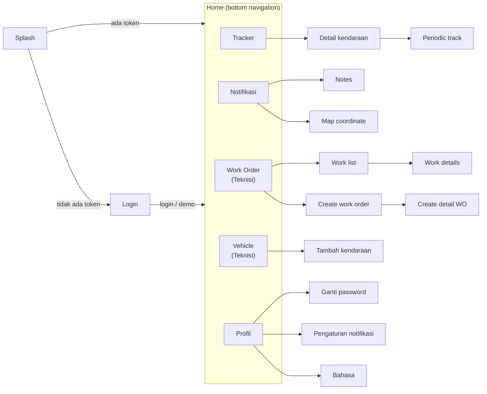

# 9. Fitur per halaman

[< 8. Arsitektur dan alur kode](08-arsitektur.md) | [Daftar isi](../README.md) | [10. Keystore dan signing Android >](10-signing-android.md)

Semua halaman ada di `packages/core/lib/screens/`. Bagian ini menjelaskan
apa yang dilakukan tiap halaman, file mana yang perlu dibuka kalau ingin
mengubahnya, dan endpoint API utamanya (relatif terhadap `BASE_URL`).

## 9.1 Peta navigasi

Tab Work Order dan Vehicle hanya muncul di build dengan
`VITE_APP_USERS="Teknisi"`, yaitu Bitrack Internal. FixTrack dan Bitrack
adalah build Customer.

## 9.2 Ringkasan

| Halaman | Folder | Yang dilakukan | Endpoint utama |
| --- | --- | --- | --- |
| Splash | `splash_screen` | Logo app, cek token, arahkan ke Login atau Home. | - |
| Login | `login` | Login email + password, login biometric, tombol demo (flag Supabase), label versi + patch. | `POST /mobile/auth/login` |
| Register | `register` | Form pendaftaran. **Masih dummy**, tidak ditautkan dari Login. | - |
| Home / Tracker | `home` | Peta semua kendaraan, pencarian plat, filter, chip aktivitas, geofence. | `/monitoring/position`, `/monitoring/`, `/vehicle-monitoring/child/fleet-group/{userId}` |
| Detail kendaraan | `vehicle_detail` | Posisi real-time, info, sensor, alamat, dashcam live. | `/monitoring/{id}`, `/vehicle/{id}`, `/dashcam/token` |
| Periodic track | `periodic_track` | Putar ulang rute kendaraan dengan chart dan alert. | `/monitoring/playback` |
| Notifikasi | `notification` | Daftar alert, filter, catatan, lokasi alert. | `/transaction-alert/`, `/mw-mapping-alert/mark-all-as-read`, `/master-option/alert` |
| Pengaturan notifikasi | `notification_settings` | Toggle Alert dan Software Update (belum tersimpan). | - |
| Work Order (Teknisi) | `work_order` | Daftar, buat, detail, assign, evidence, catatan WO. | `/work-order`, `/work-order/detail`, `/work-order/evidence`, `/work-order/notes` |
| Vehicle (Teknisi) | `vehicle` | Daftar kendaraan, filter fleet group, tambah kendaraan. | `/mobile/vehicle`, `/master-option/fleet-groups` |
| Tambah kendaraan | `add_vehicle` | Wizard 3 langkah. | `/master-vehicle/`, `/master-vehicle/brands`, `/master-vehicle/check-fleetify` |
| Profil | `profile` | Data user, menu pengaturan, Sign Out, label versi. | - |
| Ganti password | `change_password` | OTP lalu password baru. | `/otp/send`, `/otp/verify`, `/users/update-password/{id}` |
| Bahasa | `language` | Pilih bahasa app. | - |

## 9.3 Login (`screens/login`)

- `login_screen.dart`: latar, logo, label DEVELOPMENT (build dev), kartu
  form, dan `AppVersionLabel`.
- `widgets/form_login.dart`: input email/password, tombol login, tombol demo
  (muncul bila flag Supabase `show_register` = true). Setelah login sukses:
  tawarkan simpan biometric, minta izin notifikasi, tautkan OneSignal, lalu
  pindah ke Home dengan `pushNamedAndRemoveUntil`.
- `widgets/biometric_button.dart`: login dengan sidik jari / Face ID memakai
  kredensial yang disimpan sebelumnya.
- Proses login sendiri ada di `features/auth/` (`auth_api.dart`,
  `auth_providers.dart`).

## 9.4 Home / Tracker (`screens/home`)

- `home_screen.dart`: polling posisi tiap 30 detik; berhenti saat halaman
  tertutup halaman lain (hemat baterai dan kuota).
- `widgets/monitoring_map.dart`: peta dan marker kendaraan. Ikon truk per
  status (jalan, idle, berhenti, silence) dari
  `assets/images/trucks/`; kalau backend memberi URL ikon kendaraan, ikon itu
  yang dipakai.
- `widgets/monitoring_search_bar.dart`, `filter_tracker_bottom_sheet.dart`,
  `activity_chips.dart`: pencarian plat, filter, dan chip status aktivitas.
- `services/geofence_service.dart`: area geofence armada.
- Data peta berasal dari `features/monitoring/` (`vehiclePositionProvider`,
  `monitoringStatusProvider`).

## 9.5 Detail kendaraan (`screens/vehicle_detail`)

- `vehicle_detail.dart`: polling detail tiap 10 detik, melambat sampai 60
  detik saat request lambat atau gagal.
- `widgets/vehicle_realtime_map.dart`, `indicator_card.dart`,
  `status_label.dart`, `vehicle_information_bottom_sheet.dart`: peta, sensor
  (mesin, BBM, chiller), status, dan info kendaraan.
- `services/fetch_address.dart`: alamat dari koordinat (`GEO_REVERSE`).
- **Dashcam:** `services/dashcam_service.dart` (token dan status),
  `mettaxiot_stream_service.dart` / `stonkam_stream_service.dart` (dua vendor
  kamera), `widgets/flv_player.dart` (video FLV lewat media_kit),
  `widgets/dashcam_bottom_sheet.dart` (pilih channel, audio intercom lewat
  WebSocket), `services/g711_decoder.dart` (decoder audio).
- Periodic track dibuka lewat sheet pemilih rentang waktu
  `base/widgets/periodic_track_filter_sheet.dart`, yang lalu membuka route
  `/periodic-track`.

## 9.6 Periodic track (`screens/periodic_track`)

- Putar ulang perjalanan pada rentang waktu yang dipilih
  (`base/widgets/periodic_track_filter_sheet.dart`).
- `services/fetch_periodic.dart`: data titik dari `/monitoring/playback`.
- `services/periodic_playback_controller.dart`: logika play/pause dan
  kecepatan (`models/playback_speed.dart`).
- `widgets/periodic_map.dart`, `periodic_truck_marker.dart`,
  `periodic_point_label.dart`: peta, marker bergerak, label titik.
- `widgets/periodic_chart.dart` + `utils/chart_series.dart`: chart kecepatan
  dan sensor (syncfusion_flutter_charts), dengan pin alert yang bisa diketuk.
- `widgets/player_card.dart`: kontrol pemutar.

## 9.7 Notifikasi (`screens/notification`)

- `notification_screen.dart` + `providers/notification_provider.dart`:
  daftar alert, refresh badge tiap 30 detik, tandai semua sudah dibaca.
- `widgets/filter_notif_bottom_sheet.dart`: filter jenis alert
  (`providers/alert_type_provider.dart`, `/master-option/alert`).
- `pages/notes_screen.dart`: catatan untuk satu alert.
- `pages/map_coordinate_screen.dart`: lokasi alert di peta.

## 9.8 Work Order, khusus Teknisi (`screens/work_order`)

- `work_order.dart`: tab utama Work Order.
- `pages/work_list/`: daftar WO, `assign_work_sheet.dart` untuk assign
  teknisi.
- `pages/create_work_order/` dan `pages/create_detail_wo/`: membuat WO dan
  detailnya (form bertahap `step_one_form.dart`, `step_two_form.dart`,
  `review_form.dart`).
- `pages/work_details/`: tab detail, evidence (foto dari kamera/galeri), dan
  catatan; `work_action_sheet.dart` untuk aksi status.
- Halaman ini menerima argumen (`models/work_order_args.dart`), jadi
  didaftarkan lewat `onGenerateRoute` di `main.dart`, bukan di `routes:`.

## 9.9 Vehicle dan tambah kendaraan, khusus Teknisi

- `screens/vehicle/`: daftar kendaraan dengan infinite scroll
  (`providers/vehicle_infinite_provider.dart`), filter fleet group, cek plat
  (`services/check_license_plate.dart`).
- `screens/add_vehicle/`: wizard 3 langkah (`vehicle_info_step.dart`,
  `device_info_step.dart`, `review_step.dart`), submit lewat
  `services/submit_vehicle.dart`.

## 9.10 Profil, ganti password, bahasa

- `screens/profile/profile.dart`: nama dan role dari secure storage, avatar
  inisial, menu, Sign Out, label versi + patch.
- `screens/change_password/`: kirim OTP (`otp_service.dart`), verifikasi,
  lalu `update_password_service.dart`. Sukses = logout otomatis.
- `screens/language/language.dart`: pilih bahasa; pilihannya disimpan di
  SharedPreferences lewat `base/localization/locale_controller.dart`.
- `screens/notification_settings/`: toggle Alert dan Software Update, **belum
  tersimpan** ke mana pun.

## 9.11 Register (belum aktif)

`screens/register/` berisi form pendaftaran yang submit-nya hanya
mensimulasikan pengiriman lalu menampilkan dialog "pendaftaran sedang
dikonfirmasi". Belum terhubung ke backend, dan route-nya tidak ditautkan dari
halaman mana pun. Kalau ingin diaktifkan, perlu endpoint pendaftaran dari
backend dan tombol di halaman Login.

---

[< 8. Arsitektur dan alur kode](08-arsitektur.md) | [Daftar isi](../README.md) | [10. Keystore dan signing Android >](10-signing-android.md)
