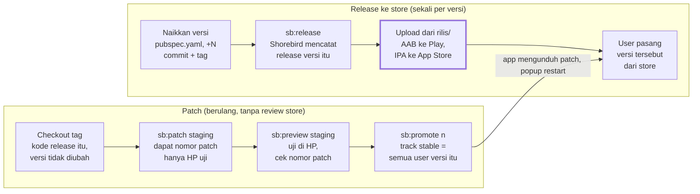

# 14. Shorebird: release dan patch

[< 13. Rilis iOS ke App Store](13-rilis-ios.md) | [Daftar isi](../README.md) | [15. Checklist rilis dan patch >](15-checklist.md)

Shorebird memungkinkan perbaikan **kode Dart** dikirim langsung ke HP user dalam hitungan menit, tanpa review Play Store atau App Store. Syaratnya, versi app di HP user harus hasil `shorebird release`, dan perubahannya hanya kode Dart.

## 14.1 Konsep

- **Release** = build lengkap (AAB/IPA) yang dicatat di server Shorebird dengan nomor versinya (mis. `1.1.0+13`), lalu di-upload ke store.
- **Patch** = selisih kode Dart dibanding release tertentu. Patch selalu terikat ke **satu** versi release. User di versi lain tidak menerimanya.
- **Track:** patch dikirim dulu ke track `staging` (hanya HP yang memasang preview staging), diuji, lalu dipindah ke `stable` (semua user versi itu).
- Setiap app punya `app_id` sendiri di `apps/<app>/shorebird.yaml`: FixTrack `58d6f77b-...`, Bitrack `4f07b9c0-...`, Bitrack Internal `b4ca9cba-...`. Dashboard: console.shorebird.dev.

Baris atas dikerjakan sekali per versi dan melewati review store. Baris bawah bisa diulang kapan saja untuk versi yang sudah beredar. Kotak bergaris tebal ("Upload dari rilis/") adalah langkah yang paling sering salah. Patch terikat ke satu versi release; perubahan native, asset, atau `.env` berarti mengulang baris atas.

## 14.2 Yang bisa dan tidak bisa di-patch

| Bisa di-patch | Harus rilis store baru |
| --- | --- |
| Perubahan kode `.dart` di `packages/core` atau `apps/<app>/lib`: perbaikan bug, teks, tampilan, logika, endpoint | Menambah atau meng-upgrade package yang punya kode native (mis. `package_info_plus` saat label versi ditambahkan) |
| Perubahan terjemahan `.arb` (karena jadi kode Dart) | Perubahan di `android/` atau `ios/` (izin, bundle id, manifest, Info.plist, icon, splash) |
|  | Perubahan asset (gambar, `.env`, `shorebird.yaml`) |
|  | Ganti versi Flutter |

Perubahan `.env` tidak bisa di-patch karena `.env` adalah asset. Kalau URL server berubah, butuh rilis store baru.

## 14.3 Cara app mengunduh patch

`auto_update` sengaja dimatikan (`auto_update: false` di `shorebird.yaml`) supaya app bisa memberi tahu user. Alurnya:

1. `main()` membaca nomor patch yang sedang berjalan (`initCurrentPatch()` di `base/services/code_push_service.dart`), dipakai label versi di Login dan Profil.
2. `PatchDownloadBanner` (membungkus semua halaman di `MaterialApp.builder`) mengecek patch saat app pertama tampil **dan** setiap kali app kembali dari background.
3. Kalau ada patch baru, app mengunduhnya. Bila unduhan lebih dari 1 detik, banner "Mengunduh pembaruan..." tampil di atas layar.
4. Setelah terunduh, popup "pembaruan siap" muncul maksimal sekali per sesi, setelah splash lewat. Di Android ada tombol mulai ulang otomatis; di iOS user diminta menutup dan membuka app sendiri. Popup selalu bisa ditutup; patch tetap aktif sendiri di pembukaan app berikutnya.

Di build tanpa engine Shorebird (`flutter run`, build biasa), semua fungsi ini otomatis tidak melakukan apa-apa.

## 14.4 Alur patch langkah demi langkah

Contoh untuk FixTrack Android versi `1.1.0+13` yang sudah ada di Play Store. Ganti `fixtrack` dengan `bitrack` atau `internal`, dan `android` dengan `ios` (di Mac) sesuai kebutuhan.

1. **Checkout commit release-nya**, bukan `main` terbaru: `git checkout fixtrack-1.1.0+13` (tag dari [bagian 12](12-rilis-android.md)), lalu buat branch perbaikan `git checkout -b hotfix/fixtrack-1.1.0+13`. Patch dibangun dari kode ini; kalau dibangun dari `main` yang sudah berisi perubahan native, patch bisa gagal atau berbahaya.
2. **Jangan ubah `version:`** di `pubspec.yaml`. Skrip memakai versi itu untuk mencari release-nya.
3. Perbaiki bug di kode Dart. Uji dengan `melos run fixtrack:prod`.
4. **Kirim patch ke staging:** `melos run fixtrack:sb:patch:android:staging`. Catat nomor patch dari output (`Published Patch ...`). Kalau tidak ada perubahan Dart, skrip melapor "Tidak ada perubahan Dart".
5. **Uji di HP:** `melos run fixtrack:sb:preview:android:staging`. Ini memasang release + patch staging ke HP yang tersambung. Buka Profil: label versi harus menampilkan nomor patch baru.
6. **Promote ke semua user:** `melos run fixtrack:sb:promote <nomor-patch>`, mis. `melos run fixtrack:sb:promote 3`. Berhasil bila tercetak "Patch 3 sekarang aktif untuk semua user release 1.1.0+13".
7. **Bawa perbaikan ke `main`:** merge atau cherry-pick commit hotfix ke `main` supaya rilis berikutnya juga berisi perbaikan itu.
8. Kalau satu perbaikan harus sampai ke beberapa versi yang beredar, ulangi langkah 1-6 untuk setiap versi (setiap patch terikat ke satu release).

## 14.5 Tentang perintah Shorebird di melos

Daftar lengkap perintah `<app>:sb:*` ada di [Daftar perintah](../README.md#daftar-perintah). Semuanya memanggil `tool/shorebird.dart`, yang menambahkan `--release-version` dari `pubspec.yaml`, memakai Flutter 3.38.7, membaca dart-define dari `dart_defines.prod.json`, dan memutuskan berhasil/gagal dari isi output. Jangan memanggil `shorebird` langsung.

## 14.6 Jebakan Shorebird yang sudah pernah terjadi

- **Upload AAB/IPA yang salah.** `shorebird patch` mem-build ulang ke folder `build/` yang sama, menimpa AAB release. Kalau file di `build/` yang di-upload ke store, setiap patch untuk versi itu ditolak di HP user dengan "hash mismatch". Selalu upload dari `rilis/`, dan jalankan `sb:verify` bila ragu.
- **Exit code Windows selalu 0.** `shorebird.bat` di Windows keluar dengan kode 0 walau gagal, sehingga melos selalu menulis `SUCCESS`. Percayai hanya baris `Published Release ...` / `Published Patch ...` atau pesan dari skrip.
- **Tanda `=` dipotong di Windows.** `shorebird.bat` memotong argumen di tanda `=`, jadi dart-define dibaca dari file JSON, bukan `--dart-define=K=V`.
- **Patch tanpa `--release-version`** membuat Shorebird menebak versi dengan Flutter terbaru dan gagal dengan pesan menyesatkan "Failed to build AAB". Skrip sudah menangani ini; jangan memanggil `shorebird patch` langsung.
- **Release dengan versi yang sudah ada** ditolak skrip bila `rilis/<app>-<versi>.aab` sudah ada. Naikkan build number.
- **`patches promote` sudah deprecated**; skrip memakai `patches set-track`.
- **Prompt interaktif tidak jalan lewat melos**, karena melos menyalurkan output lewat pipe. Itu sebabnya versi selalu dioper eksplisit.

## 14.7 Mengecek status release dan patch

- Dari folder app (mis. `cd apps/fixtrack`): `shorebird releases list`
  menampilkan semua release beserta platform dan versi Flutter-nya.
- Dashboard **console.shorebird.dev**: daftar release, patch per release,
  track tiap patch, dan jumlah perangkat yang sudah memasang patch.
- Di HP: buka halaman Login atau Profil. Label versi menampilkan
  `v<versi> (<build>) • Patch <n>`. Tidak ada "Patch" berarti HP itu masih
  menjalankan kode release asli.

Status per 15 Okt 2026: FixTrack Android punya release `1.1.0+11`, `+12`,
`+13`; Bitrack dan Bitrack Internal belum punya release Shorebird sama
sekali.

## 14.8 Kalau patch ternyata bermasalah

1. **Jangan panik:** patch hanya menyentuh kode Dart; versi store tetap utuh.
2. Cara tercepat: buka console.shorebird.dev > app > release > patch yang
   bermasalah, lalu **rollback** patch tersebut. HP user akan kembali ke patch
   sebelumnya (atau kode release asli) setelah app dibuka ulang.
3. Cara lain yang selalu bisa: perbaiki kodenya dan kirim patch baru lewat
   alur 14.4 (staging, uji, promote).
4. Inilah alasan patch selalu lewat **staging** dulu: uji di HP sebelum
   `promote`, karena setelah promote patch sampai ke semua user dalam
   hitungan menit.

## 14.9 Pertama kali memakai Shorebird di mesin baru

1. Install Shorebird CLI dan login: `shorebird login` (akun harus sudah
   diundang ke organisasi Shorebird, lihat
   [2. Akses dan rahasia](02-akses-dan-rahasia.md)).
2. Jalankan `shorebird doctor`.
3. Dari `apps/fixtrack`, jalankan `shorebird releases list`. Kalau daftar
   release muncul, akses sudah benar.
4. Pertama kali release/patch, Shorebird mengunduh Flutter 3.38.7 versi
   Shorebird sendiri (beberapa menit).

---

[< 13. Rilis iOS ke App Store](13-rilis-ios.md) | [Daftar isi](../README.md) | [15. Checklist rilis dan patch >](15-checklist.md)
